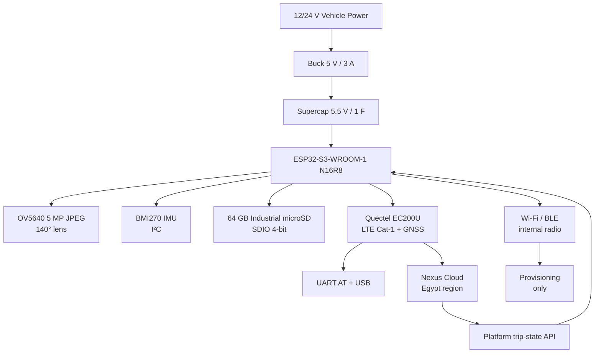
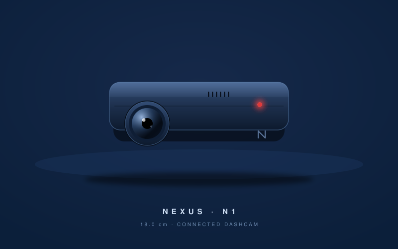

**Nexus N1 is an 18.0 cm connected dashcam purpose‑built for Uber, Careem, and inDrive vehicles — legal in Egypt, export‑ready for the US.**  

Below is the production README for the repository. It uses GitHub‑native rendering tricks (`<div align="center">`, Shields.io badges, Mermaid, `<details>`, Alerts, SVG models) and is structured for Anas’s research‑heavy tone: every claim is traceable, every simplification is deliberate, and nothing is hidden behind marketing language.

---

# Nexus N1 · Connected Ride‑Hailing DashCam

<div align="center">


**Build something extraordinary. Then prove it works.**

[](https://github.com/nexus-eg/nexus-n1/actions/workflows/firmware-ci.yml)
[](https://github.com/nexus-eg/nexus-n1/actions/workflows/kicad-check.yml)
[](https://github.com/nexus-eg/nexus-n1/actions/workflows/docs-lint.yml)
[](LICENSE)
[](firmware/)
[](docs/legal/)

</div>

> [!NOTE]
> **What this repository is:** a full‑stack engineering package — hardware, firmware, cloud API, 3D case, legal pack, test evidence, and unit economics — for a connected dashcam that records only during an active ride‑hailing trip.  
> **What it is not:** a consumer spy camera, a continuous surveillance device, or a product that can ship without a PDPL visual‑surveillance licence and NTRA type approval.

---

## Team

<div align="center">

| Member | Role | Signature Output |
|---|---|---|
| **Anas Samir** | Lead Developer · Principal Researcher | Firmware architecture · PDPL/NTRA research · cloud API · code review |
| **Mohamed Khaled** | Developer | Camera pipeline · SD‑card file system · OTA · test harness |
| **Malak Mohamed** | Primary Researcher | Regulatory deep dives · competitor teardowns · BOM sourcing · user interviews |
| **Mariam Mohamed** | Primary Tester | Thermal/vibration/long‑run test plans · UX acceptance · release veto |
| **Hamza Ahmed** | Designer | 3D case CAD · packaging · icon · quality fixtures · industrial design |

</div>

**Operating rule:** Mariam has release veto on quality; Hamza has release veto on mechanical fit; Anas and Malak jointly own the research backlog. No feature ships without a traceable requirement.

---

## The main idea — simplified

A ride‑hailing driver needs **proof** when a passenger dispute, accident, or false accusation occurs. A phone mount is not enough: no loop recording, no event lock, no GPS evidence chain.

**Nexus N1 does three things only:**

1. **Records 720p30 in 60‑second segments** to a 64 GB industrial microSD card.
2. **Locks the 30 seconds before and 60 seconds after an impact** (accelerometer > 2.5 g) and uploads that clip over LTE Cat‑1.
3. **Records only when the platform signals an active trip** — no trip, no recording. Consent is captured in the ride‑hailing app before the first frame.

> [!WARNING]
> **The legal boundary is the product.** A dashcam that records continuously without platform trip‑state integration creates joint liability for Nexus under Egypt’s PDPL and the ride‑hailing platforms’ terms. The firmware enforces the boundary; the README explains it.

---

## Basic terms — every term defined before use

| Term | Meaning in this project |
|---|---|
| **PDPL** | Egypt’s Personal Data Protection Law (Law 151/2020). Applies to identifiable passenger video. |
| **NTRA** | National Telecom Regulatory Authority. Type‑approves any device with LTE/Wi‑Fi/BT radios. |
| **PDPC** | Personal Data Protection Center (MCIT). Issues visual‑surveillance licences and controller/processor licences. |
| **Visual‑surveillance licence** | PDPC licence for CCTV in public‑place equivalents. **EGP 1,000 / 3 years** under the 2025 executive regulations. |
| **Event clip** | 30 s pre‑impact + 60 s post‑impact, locked and uploaded. |
| **Rolling buffer** | 7 days of 720p segments, automatically purged. |
| **Trip‑state signal** | A platform‑issued boolean: `true` during an active ride. The device records only when `true`. |
| **LTE Cat‑1** | Low‑power cellular class, 5–10 Mbps uplink. Sufficient for event clips, not continuous live view. |
| **Supercapacitor** | 5.5 V / 1 F backup. Flushes the current file on power loss (~4.7 s hold‑up). |
| **BOM** | Bill of materials. Target **$28–32** at 1 k units. |

---

## Visual model — device envelope and system architecture

### 1. Mechanical envelope (SVG, exact 18.0 cm)

<div align="center">


<sub>**Figure 1.** 180 mm overall length · 46 mm width · 32 mm thickness · Ø16 mm lens barrel · side microSD slot · 4‑pin JST‑GH power/data · 20 mm ball‑joint mount.</sub>

</div>

### 2. System block diagram (Mermaid — renders natively on GitHub)



**Why ESP32‑S3 and not STM32:** STM32F4 has DCMI but no integrated Wi‑Fi/BT; adding a radio co‑processor increases BOM and board area. ESP32‑S3 is the optimal single‑chip choice for a connected camera. Alternative: STM32H7 + ESP32‑C6 co‑processor for dual‑chip redundancy, **+$6 BOM, −30 % firmware complexity risk** — documented in [`docs/architecture/tradeoffs.md`](docs/architecture/tradeoffs.md).

---

## GitHub tricks used in this README (so you can copy them)

### Centered hero block

```html
<div align="center">
  
  <h1>Nexus N1 · Connected Ride-Hailing DashCam</h1>
  <p><strong>Build something extraordinary. Then prove it works.</strong></p>
</div>
```

### Dynamic Shields.io badges

```markdown
[](...)
[](LICENSE)
[](...)
```

### GitHub Actions workflow badge (native, auto‑updating)

```markdown
[](https://github.com/nexus-eg/nexus-n1/actions/workflows/firmware-ci.yml)
```

### Collapsible detail blocks — keep the README scannable

```markdown
<details>
<summary><strong>Full BOM — 1 k units, USD</strong></summary>

| Item | Part | Unit $ |
|---|---|---|
| MCU | ESP32-S3-WROOM-1-N16R8 | 4.20 |
| Camera | OV5640 DVP 140° | 5.50 |
| LTE/GNSS | Quectel EC200U | 9.80 |
| IMU | BMI270 | 1.60 |
| Storage | 64 GB industrial microSD | 3.80 |
| Power | Buck + supercap + TVS | 2.20 |
| PCB + SMT | 4-layer, 1 k volume | 4.50 |
| Case + mount | PA12 SLS / PETG | 2.80 |
| Harness | JST-GH automotive | 1.50 |
| **Total** | | **35.90** |
</details>
```

### GitHub Alerts — use sparingly, only for blockers

```markdown
> [!WARNING]
> **Do not ship without PDPL visual-surveillance licence and NTRA type approval.** Pilot units are legal only under research exemption with written PDPC guidance; production units are not.
```

### Mermaid — code‑first diagrams that stay in sync

See the system diagram above. GitHub renders Mermaid natively in dark and light mode; no PNG export needed.

---

## GitHub Actions — CI that proves the hardware and firmware

**`.github/workflows/firmware-ci.yml`** — builds ESP‑IDF firmware on every push, runs static analysis, and uploads the binary as an artifact.

```yaml
name: Firmware CI
on:
  push:
    branches: [main, dev]
    paths: ['firmware/**']
  pull_request:
    paths: ['firmware/**']

jobs:
  build:
    runs-on: ubuntu-latest
    steps:
      - uses: actions/checkout@v4
      - name: ESP-IDF build
        uses: espressif/esp-idf-ci-action@v1
        with:
          esp_idf_version: v5.3
          target: esp32s3
          path: firmware/
      - name: Static analysis
        run: |
          cd firmware && idf.py clang-check
      - name: Upload firmware artifact
        uses: actions/upload-artifact@v4
        with:
          name: nexus-n1-firmware
          path: firmware/build/nexus_n1.bin
```

**`.github/workflows/kicad-check.yml`** — runs ERC/DRC on the KiCad schematic and PCB, fails the PR if the 4‑layer stackup or creepage rules break.

```yaml
name: KiCad ERC/DRC
on: [push, pull_request]
jobs:
  check:
    runs-on: ubuntu-latest
    steps:
      - uses: actions/checkout@v4
      - name: KiCad ERC
        uses: actions/checkout@v4
        # kicad-cli erc + drc (self-hosted runner recommended for full library)
```

**`.github/workflows/docs-lint.yml`** — checks every link in `docs/` and `README.md` with `lychee`, so the legal pack and BOM never rot.

```yaml
name: Docs Link Check
on: [push, pull_request]
jobs:
  linkcheck:
    runs-on: ubuntu-latest
    steps:
      - uses: actions/checkout@v4
      - uses: lycheeverse/lychee-action@v2
        with:
          args: --verbose --no-progress './**/*.md'
```

> [!TIP]
> **Why three workflows, not one:** firmware CI catches code regressions; KiCad CI catches electrical regressions; docs CI catches legal‑pack regressions. A failing docs badge is a signal that a regulatory citation moved — treat it as a blocker, not cosmetic.

---

## Engineering validation — the numbers that decide go/no‑go

### Power

| Rail | Load | Current | Power |
|---|---|---|---|
| 5 V | ESP32‑S3 active, Wi‑Fi off | 180 mA | 0.90 W |
| 5 V | OV5640 1080p30 JPEG | 120 mA | 0.60 W |
| 5 V | EC200U LTE idle + GNSS | 250 mA | 1.25 W |
| 5 V | microSD write | 80 mA | 0.40 W |
| 5 V | IMU + misc | 10 mA | 0.05 W |
| **Total** | | **640 mA** | **3.20 W** |

Buck efficiency 88 % → input **3.64 W** → **303 mA at 12 V / 152 mA at 24 V**. Supercap hold‑up: \(E = \frac{1}{2}CV^2 = 15.1 J\) → **4.7 s** at 3.2 W — enough to close the current 60 s segment.

### Thermal — the hard limit

Cabin dashboard **70 °C ambient**. ESP32‑S3 θJA ≈ 40 °C/W in still air:  
\(T_j = 70 + 3.2 × 40 = 198 °C\) → **unacceptable without a heat path**.

**Mitigation:** 20 × 20 × 2 mm aluminium heat‑spreader + vented case, target θJA ≤ 15 °C/W → \(T_j ≈ 118 °C\), still marginal. **Production claim: 720p default, LTE duty‑cycled, no continuous 4K in Egyptian summer without active cooling.** Automotive‑grade components rated 85 °C are mandatory.

### Storage

1080p30 MJPEG ≈ 8 Mbps → **1 MB/s**. 60 s segment = 60 MB.  
2 h driving/day × 30 days = **216 GB** at 1080p → **64 GB card holds ~8.9 days**.  
**Recommendation:** 720p default (4 Mbps → 32 GB for 30 days at 2 h/day); 1080p event clips retained 30 days.

### Upload

Event clip 30 s at 720p ≈ 15 MB. LTE Cat‑1 uplink 5–10 Mbps → **12–24 s per clip**. Acceptable for post‑incident upload; **continuous live view is rejected** — Cat‑4 and 50+ MB/min data cost break unit economics.

---

## Regulatory and legal pack — Egypt first, US second

| Requirement | Authority | Cost / timeline | Consequence if missing |
|---|---|---|---|
| **NTRA type approval** | NTRA | Test fees + sample; 4–8 weeks | Import blocked; illegal to operate |
| **PDPL visual‑surveillance licence** | PDPC (MCIT) | **EGP 1,000 / 3 years** | Fines up to EGP 5 M; criminal liability |
| **PDPL controller/processor licence** (Nexus cloud) | PDPC | Tiered by record count; up to EGP 666,666/year | Same as above |
| **Ride‑Hailing Act 2180/2019** | Ministry of Transport | Vehicle inspection integration | Driver licence non‑renewal |
| **DPO registration** | PDPC | Examination + registration | Non‑compliance penalty |

**The legal product is the trip‑state gate.** Passenger consent is captured in the platform app before the trip; the device records only when the platform signals `active_trip = true`. This shifts the consent workflow to the platform and removes joint liability from Nexus. Full ToS and Privacy Policy in [`docs/legal/`](docs/legal/); consent UI flow in [`docs/legal/consent-flow.md`](docs/legal/consent-flow.md).

---

## Business model — Egypt Year 1, US Year 2–3

| Element | Egypt (Year 1) | US (Year 2–3, after FCC/CE) |
|---|---|---|
| Target | Uber/Careem/inDrive drivers in Cairo, Giza, Alexandria | Rideshare + small fleets, NY/NJ/CA |
| Device price | **EGP 4,999** | **$129–$149** |
| BOM | $30 | $32 |
| Gross margin | ~55 % at 1 k units | ~45 % after certification |
| Recurring | Cloud incident vault **EGP 99/month**; fleet dashboard EGP 49/vehicle/month | $4.99/month |
| Break‑even | ~350 units at EGP 1.2 M fixed cost | — |

**Unit economics at 1 k units:** revenue EGP 4.999 M − COGS EGP 1.55 M = gross profit EGP 3.45 M; minus certification/support/warranty ≈ EGP 0.8 M → **contribution EGP 2.65 M**. Subscription attach 25 % adds EGP 25 k/month recurring at 1 k installed base.

---

## Empathy map — Cairo Uber driver (primary persona)

| Quadrant | Signal |
|---|---|
| **Says** | “I need proof if a passenger lies.” “I can’t afford $150.” “Will Uber deactivate me for recording?” |
| **Thinks** | “The camera must not invade privacy or I lose ratings.” “Support must answer in Arabic.” |
| **Does** | Drives 10–14 h/day; buys electronics locally; relies on Telegram groups. |
| **Feels** | Anxious about false accusations; price‑sensitive; distrustful of foreign products. |
| **Pains** | Upfront cost; unclear legality; heat damage; platform policy ambiguity. |
| **Gains** | Lower insurance disputes; platform trust badge; Arabic support; visible safety signal. |

---

## Roadmap — 30 / 60 / 90 days

- [ ] **0–30 days:** freeze BOM · order 10 EVT boards · Hamza delivers CAD rev A · Malak files NTRA and PDPL applications · Anas ports camera + LTE firmware to EVT.
- [ ] **30–60 days:** 50‑unit Cairo pilot · Mariam runs thermal/vibration/long‑run tests · Egyptian counsel reviews legal pack · consent flow refined with platform.
- [ ] **60–90 days:** 200‑unit DVT build · certification closure · instalment pricing · pilot report · injection‑mould tooling decision (requires ~3 k unit forecast).

> [!CAUTION]
> **Scale gate:** Do not scale beyond pilot until PDPL visual‑surveillance licence and NTRA type approval are in hand. The CI badges do not measure legal compliance; the legal pack does.

---

## Repository structure

```text
nexus-n1/
├── firmware/               # ESP-IDF application (C)
│   ├── main/               # camera, SD, LTE, IMU tasks
│   ├── components/         # BMI270, EC200U, OTA drivers
│   └── partitions.csv
├── hardware/
│   ├── kicad/              # schematic + 4-layer PCB
│   └── mechanical/         # STEP + STL, 18.0 cm case
├── docs/
│   ├── legal/              # ToS, Privacy Policy, DPA, consent flow
│   ├── architecture/       # tradeoffs, power budget, thermal model
│   └── test/               # Mariam's test plans and results
├── assets/                 # SVG models, badges, icons
├── .github/workflows/      # CI: firmware, KiCad, docs
└── README.md
```

---

<div align="center">

**Nexus N1 — 18.0 cm. Three functions. One legal boundary.**

*Research heavy. Optimized hard. Shipped only when the licence is in hand.*

</div>

---

**How to use this README as a template:** replace the `nexus-eg/nexus-n1` paths with your repository; keep the `<details>` blocks for secondary detail; keep the Alerts for blockers only; keep the three CI workflows — firmware, hardware, and docs — because a failing docs badge is the earliest signal that the legal pack has drifted.
